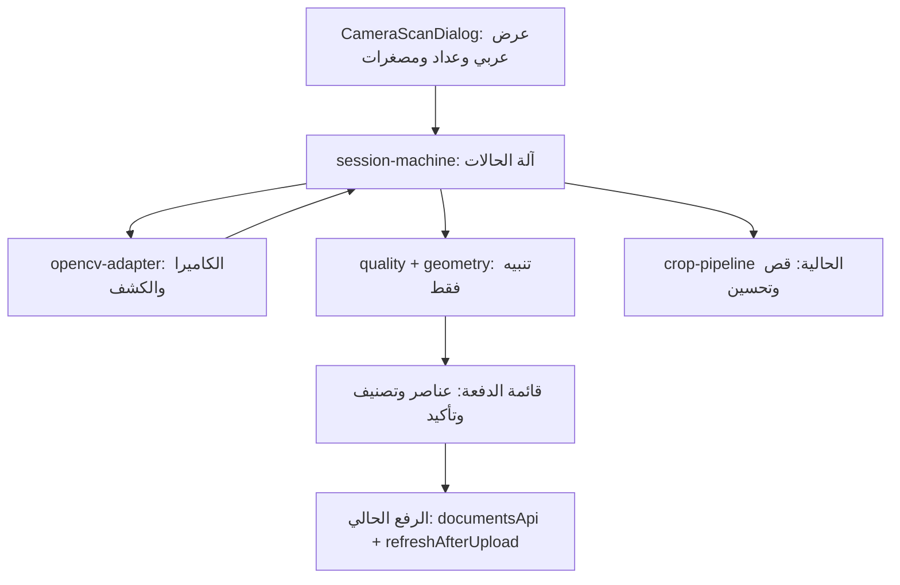

# معمارية وخطة: مسح جماعي بالهاتف (محلي فقط، بلا مقارنة محتوى)

> المصدر الملزم: `plan/feature-context-camera-batch-scan.md` (Q1–Q3 + R1–R3). لا تغيير قرارات هنا. لا كود حتى اعتماد الخطة.

## 1. القرارات المثبتة (مرجع سريع)

- Q1: OpenCV.js/WASM محلي، تحميل كسول عند فتح الجلسة فقط، إعادة استخدام `crop-pipeline`، مسار يدوي احتياطي دائم.
- Q2/R2: الجودة تنبيه فقط. Auto Capture يشترط شرطين لا غير: مضلع كافٍ + ثبات مقبول. الضبابية والإضاءة واللمعان لا تمنع التقاطًا ولا إضافة. العنصر ذو الشارة يُرفع فقط بعد تأكيد بشري.
- Q3: لا رفع قبل نوع وصاحب صريحين لكل عنصر. لا مالك افتراضي صامت.
- R1: منع التكرار = قفل حدث (`captureId`/`sessionId`) + حالة انتظار حتى إزالة الورقة وظهور جديدة. بلا بصمات ولا مقارنة محتوى ولا مؤقت إعادة تفعيل.
- R3: لا قبول 409 كنجاح إلا بمطابقة `FileID` + `DocumentTypeID` + IDs المالك مع الطلب، مع عرض المالك الحقيقي عند التعارض.

## 2. نظرة معمارية

مالك واحد للكاميرا. ثلاث طبقات معزولة: رؤية (OpenCV)، قرار (آلة حالات)، عرض (React). القاعدة: الطبقات لا تتجاوز حدودها — المحرك لا يقرر قبولًا، والواجهة لا تقرأ إطارات الفيديو، والجودة لا تمنع.

## 3. المكونات وحدود المسؤولية

| المكون | المسؤولية | الممنوع عليه |
|---|---|---|
| `CameraScanDialog.tsx` (جديد) | عرض الإطار كاملًا بلا `object-cover`، تعليمات عربية قصيرة، عدّاد، مصغرة أخيرة، أزرار: التقاط يدوي، إيقاف مؤقت، تبديل كاميرا، إنهاء | قراءة بكسلات الفيديو، قرار قبول، تخزين صور مفكوكة في state |
| `useCameraScanSession.ts` (جديد) | ربط آلة الحالات بـ React، دورة حياة (فتح/خلفية/إغلاق)، إلغاء عمليات معلقة | منطق كشف أو جودة داخل الخطاف |
| `lib/document-scanner/types.ts` (جديد) | عقد مشترك: أنواع الحالات والأحداث والتنبيهات والعناصر | أي import من SDK أو React |
| `lib/document-scanner/session-machine.ts` (جديد) | آلة حالات خالصة بلا واجهة، قابلة لاختبار الوحدات | أي DOM أو `getUserMedia` |
| `lib/document-scanner/opencv-adapter.ts` (جديد) | ملكية الكاميرا، تحميل WASM كسول، كشف مضلع، إغلاق وتحرير | قرار قبول/رفض، تخزين دائم |
| `lib/document-scanner/quality.ts` + `geometry.ts` (جديد) | مؤشرات تنبيهية + تحويل إحداثيات الزوايا بين دقة التحليل والحفظ | منع التقاط أو إضافة |
| `crop-pipeline.ts` (تعديل) | القص والتحسين كما هو، مع فصل التصحيح عن التحسين ومنع إعادة المعالجة | كشف تلقائي جديد هنا |
| `BulkUploadDialog.tsx` (تعديل) | استضافة الجلسة، إلزام نوع/صاحب، تأكيد الشارة، إصلاح مطابقة 409 | فتح بث ثانٍ أثناء الجلسة |
| `FileUploader.tsx` (تعديل) | إصلاح دلالة الإلغاء وفشل التحقق؛ يبقى مسارًا يدويًا خارج الجلسة | أي تغيير في مسار الماسح WIA |
| `ImageCropperDialog.tsx` + `CornerEditor.tsx` (تعديل) | نتائج صريحة: إلغاء جديد يتجاهل، تأكيد قص يقبل بعد تحقق، فشل يبقي المحرر مفتوحًا | قبول ضمني عند الخطأ |

ملفات مسقطة نهائيًا: `similarity.ts`، أي حوار اشتباه، أي مخزن بصمات، أي مسودات IndexedDB في هذه الميزة.

## 4. آلة الحالات

الحالات: `idle`، `initializing`، `searching`، `stabilizing`، `processing` (مقفلة)، `waitingRemoval`، `reviewPause`، `paused`، `ended`.

| الحالة | الدخول | السلوك | الخروج |
|---|---|---|---|
| `initializing` | فتح الجلسة | تحميل OpenCV كسول، فحص قدرات الجهاز، طلب صلاحية الكاميرا | نجاح ← `searching`؛ فشل صلاحية/موارد ← رسالة + مسار يدوي |
| `searching` | جاهزية البث | عرض حدود المضلع وتعليمات، لا التقاط | مضلع صالح ← `stabilizing`؛ إيقاف ← `paused` |
| `stabilizing` | مضلع صالح | تتبع حركة الزوايا والمحتوى خلال نافذة؛ أي حركة/تدهور يعيد التتبع | ثبات ضمن العتبة ← التقاط (تلقائي أو يدوي) ← `processing` |
| `processing` | بدء التقاط | قفل متزامن فوري + `captureId`؛ تثبيت الصورة والزوايا؛ قص؛ فحص جودة تنبيهي؛ إضافة للقائمة | قبول ← `waitingRemoval`؛ فشل ← رسالة وتعليمات وإعادة محاولة (لا انتقال تلقائي) |
| `waitingRemoval` | قبول عنصر | تعطيل Auto Capture. مسؤولية وحيدة: التأكد من إزالة الوثيقة من الإطار ثم إعادة تسليح الالتقاط. لا منطق ثبات هنا. عند ظهور مضلع جديد ← انتقال لـ `searching`، والثبات يحسم فقط داخل `stabilizing` عبر المسار المعتاد | إزالة مؤكدة (اختفاء لعدة إطارات متتالية) ← تسليح؛ مضلع جديد ← `searching`؛ إنهاء ← `ended` |
| `reviewPause` | عنصر بشارة يحتاج قرارًا فوريًا (إعداد) | إيقاف التلقائي حتى تأكيد/إعادة تصوير/تجاهل | قرار المستخدم ← `waitingRemoval` أو `searching` |
| `paused` / `ended` | إيقاف مؤقت / إنهاء / خلفية الصفحة | إلغاء كل العمليات المعلقة، تحرير البث، الاحتفاظ بالقائمة | استئناف يعيد تهيئة البث دون تصفير القائمة |

قواعد صلبة:
1. كل محاولة `captureId`، كل جلسة `sessionId`. نتائج جلسة منتهية مرفوضة دائمًا.
2. القفل متزامن قبل أي `await`. تحديث state وحده لا يمنع التقاطًا مزدوجًا.
3. لا عبارة «تمت الإضافة» إلا بعد قبول القائمة فعليًا.
4. الصورة والزوايا والدوران من مصدر دقة واحد. أي تصوير ثابت بدقة مختلفة (`ImageCapture.takePhoto` لاحقًا) يعيد التحقق من الزوايا.
5. الالتقاط اليدوي يتجاوز شرط الثبات وشرط المضلع معًا عند الحاجة. تعذر كشف OpenCV للحواف لا يمنع التصوير — تضاف الصورة للقائمة ثم يحدد المستخدم الزوايا يدويًا في `CornerEditor`. يبقى خاضعًا للقفل والجودة التنبيهية والتصنيف اللاحق.
6. فقدان المضلع لحظيًا (يد/تركيز) لا يعد إزالة. لا عدّ إطارات مفردة. ولا يُبنى أي مسار ثبات موازٍ داخل `waitingRemoval`.

## 5. تدفق البيانات وفصل الدقات

- دقة التحليل (كشف + ثبات): صغيرة حسب الجهاز (`getOptimalProcessingSize`: عالٍ 1536 / متوسط 1024 / منخفض 768) — كافية للمضلع ورخيصة على البطارية.
- دقة الحفظ: من إطار كامل الدقة عند لحظة القفل فقط، ثم قص عبر `crop-pipeline` ضمن ميزانية `resolveMaxPixels` (ذاكرة الجهاز أو tier).
- مؤشرات الجودة تُحسب على منطقة الوثيقة المقصوصة قبل أي تحسين تجميلي (زيادة الحدة الاصطناعية تخفي الضبابية).
- الافتراضي: ألوان أصلية. تحسين التباين أو الأبيض/الأسود خيار معاينة فقط — الأختام والتواقيع لا تُمحى بفلتر افتراضي.

## 6. تكامل OpenCV.js/WASM

- اعتماد محلي مثبت الإصدار عبر `ui/package.json` + ملف القفل. ملفات WASM تُستضاف من نفس أصل الواجهة (لا CDN خارجي في الإنتاج — يعمل دون إنترنت إضافي ولا تسرب صور).
- تحميل كسول عند أول فتح للجلسة فقط (`import()` ديناميكي + chunk منفصل في `vite.config.ts`) حتى لا يتضخم التحميل الأولي.
- المحوّل يعزل أنواع SDK عن باقي التطبيق: الواجهة تستقبل مضلعًا وإحداثيات وأخطاء مغلقة فقط.
- السقوط: فشل تحميل/تهيئة/كشف ← مسار يدوي كامل (تصوير + `CornerEditor`) دون تعطيل الجلسة.
- الإغلاق: إيقاف tracks، تحرير مخازن OpenCV. لا يُفترض إلغاء `import()` ديناميكي فعليًا — عند إغلاق الجلسة تُتجاهل نتيجة التحميل المتأخرة: لا تهيئة ولا احتفاظ بموارد لجلسة منتهية (حارس `sessionId`/عداد عملية).

## 7. الذاكرة والأداء على الهاتف

- عملية معالجة واحدة قيد التنفيذ دائمًا. لا تتراكم إطارات. المخازن محدودة (تجمع canvas الحالي بحد أقصى 3 — `crop-pipeline.ts:49`).
- لا فيديو ولا صور مفكوكة في Zustand أو React state. القائمة تحتفظ بملفات مضغوطة ومصغرات صغيرة فقط.
- إيقاف الالتقاط عند انتقال الصفحة للخلفية. إعادة تهيئة عند العودة دون تصفير القائمة.
- ضغط الموارد (ذاكرة/حرارة): إيقاف الجلسة برسالة عربية واضحة مع الاحتفاظ بالمقبول. لا استمرار حتى انهيار الصفحة.
- حد أقصى لعدد عناصر الجلسة configurable (قيمة افتراضية مبدئية 50، ليست نهائية — تعاير على الأجهزة الفعلية) مع تحذير مبكر عند الاقتراب.

## 8. الإلغاء والأخطاء والحالات الحدية

| الحدث | السلوك |
|---|---|
| إلغاء التقاط جديد | تجاهل الصورة، بقاء الحالة والقائمة |
| إلغاء تعديل صورة موجودة | إبقاء النسخة السابقة |
| فشل قص/تحقق | المحرر يبقى مفتوحًا + رسالة سبب عربية (هذا إصلاح مطلوب — السلوك الحالي يغلق أحيانًا) |
| رفض صلاحية الكاميرا | رسالة سبب + زر مسار يدوي (اختيار ملف/كاميرا النظام) |
| انقطاع الكاميرا أثناء الجلسة | إيقاف تلقائي + الاحتفاظ بالقائمة + زر استئناف |
| فشل تحميل OpenCV | سقوط صامت للمسار اليدوي + تنبيه واحد غير مزعج |
| إغلاق الجلسة أثناء معالجة | إلغاء `AbortSignal`، رفض النتيجة المتأخرة، تحرير البث |
| زر رجوع المتصفح/تحديث | القائمة الحالية في الذاكرة تُفقد (لا مسودات في هذه المرحلة) — يُعلن ذلك بوضوح قبل الإنهاء عند وجود عناصر غير مرفوعة |

إدارة التركيز وقارئ الشاشة: إعلان الحالات المهمة (قبول، شارة مراجعة، انتظار إزالة، أخطاء) فقط. لا إعلان لكل إطار. دعم لوحة المفاتيح الكامل للأزرار والقائمة.

## 9. إصلاح 409 + بوابات الرفع (R3 + Q2 + Q3)

- القاعدة: `BulkUploadDialog.tsx:763-778` يُعدل لمطابقة رد 409 مع الطلب (`FileID` + `DocumentTypeID` + IDs المالك الأربعة) قبل أي نجاح. عدم المطابقة = حالة خطأ تعرض `EntityName`/`EntityType` للوثيقة الموجودة.
- لا مالك افتراضي صامت: `ownerEntity: "retiree"` (`:582`) يتحول لاختيار صريح إجباري. زر الرفع النهائي معطل حتى: كل عنصر له نوع + صاحب، وكل عنصر ذي شارة مؤكد بشريًا.
- مسار الرفع نفسه لا يتغير: توازي 3، `deferPostProcessing:true`، `refreshAfterUpload` مرة واحدة، `uploadedIdsRef` يمنع إعادة رفع الناجح.
- لا تغيير خلفي: رد 409 يحمل كل الحقول اللازمة (`MapToDto:1361-1390`).

## 10. خطة التنفيذ (5 مراحل، بوابة لكل مرحلة)

### م1: إصلاح التدفق الحالي (بلا OpenCV)
- الملفات: `BulkUploadDialog.tsx` (مطابقة 409 + إلزام نوع/صاحب + عرض المالك الحقيقي)، `FileUploader.tsx` (دلالة إلغاء/فشل تحقق)، `ImageCropperDialog.tsx` + `CornerEditor.tsx` (نتائج صريحة).
- البوابة: 409 بمالك مختلف = خطأ يذكر المالك ولا يسجل نجاحًا. رفع بلا تصنيف مستحيل. فشل التحقق يبقي المحرر مفتوحًا. `npm run build` + `npm test` نظيفان.

### م2: محرك OpenCV المحلي
- الملفات: اعتماد + chunk منفصل + `opencv-adapter.ts` (تحميل كسول/كشف/إغلاق) + سقوط يدوي.
- البوابة: يعمل على هاتف ضعيف (tier منخفض) بلا انهيار. فشل التحميل = يدوي كامل. تحرير البث مؤكد بعد الإغلاق.

### م3: آلة الحالات + بوابة الإزالة + قفل الحدث
- الملفات: `types.ts` + `session-machine.ts` + `useCameraScanSession.ts` + `CameraScanDialog.tsx` (هيكل).
- البوابة: ورقة ثابتة لا تعيد تصويرًا. فقد لحظي لا يفعل. نتائج متأخرة/مزدوجة مرفوضة. اختبارات وحدات لكل انتقال.

### م4: الجودة التنبيهية + التأكيد الإجباري
- الملفات: `quality.ts` + `geometry.ts` + شارة "تحتاج مراجعة" + حجب زر الرفع حتى التأكيد.
- البوابة: معايرة على عينات عربية وخط يدوي وأختام. لا رفض تلقائي في أي عينة. الفحص قبل التحسين التجميلي.

### م5: الدمج والإطلاق
- دمج القائمة والتصنيف والرفع، اختبار أجهزة (iPhone Safari، Android قوي/ضعيف، Edge/Chrome)، بيئة HTTPS للاختبار، تفعيل بإعداد قابل للإيقاف.
- البوابة: `lint` بلا جديد عن baseline، `build` + `test` نظيفان، عدم تراجع (رفع عادي، ماسح WIA، قص حالي، إعادة رفع).

## 11. الاختبارات ومعايير القبول

- وحدات (إطار `node --test` الحالي): انتقالات الحالات، أحداث متزامنة، نتائج بعد إغلاق، قبول واحد لكل حدث، مطابقة 409 (مطابق/مختلف مالك/مختلف نوع)، حجب رفع (بلا نوع، بلا صاحب، شارة بلا تأكيد).
- عينات صور/فيديو: خلفية بيضاء ومزدحمة، حواف ناقصة، ضبابية، لمعان على ختم، ظلال، ميل ودوران، أختام وخط يدوي عربي.
- بوابة الورقة: ثابتة صامتة، إزالة ثم جديدة تفعّل، فقد لحظي لا يفعّل، إعادة نفس الورقة تقبل كعنصر جديد (موثق كسلوك مقبول).
- Playwright: إلغاء قص، فشل تحقق، تصنيف إجباري، مسار يدوي كامل، انقطاع كاميرا، رفض صلاحية.
- أجهزة فعلية + موارد: جلسة طويلة، فتح/إغلاق متكرر، ضغط ذاكرة، خلفية/مقدمة.
- خلفية: xUnit الحالية لتكرار الخادم. لا Moq لادعاءات التزامن.
- معايير قبول نهائية: لا إضافة مزدوجة من حدث واحد. لا تصوير لورقة ثابتة. لا فقدان مقبول عند فشل لاحق. الكاميرا محررة بعد كل إغلاق. النوع والصاحب صريحان قبل أي رفع. صور الوثائق لا تدخل السجلات أبدًا.

## 12. مخاطر وخارج نطاق (مثبت)

- الورق المنحني، لمعان يغطي بيانات جوهرية، كاميرا بلا تفاصيل كافية، نموذجان متطابقان تقريبًا: الحل مراجعة/إعادة تصوير/ماسح. اختيار المكتبة لا يحلها.
- نفس الورقة مرتين بلا كشف: مسؤولية المستخدم والمصغرات — مقبول بقرار صريح.
- خارج النطاق: SDK تجاري، مقارنة محتوى، OCR، مسودات IndexedDB، idempotency خلفي (عمل مستقل عالي الأولوية)، دمج وجهي الهوية تلقائيًا.

## 13. حالة التنفيذ (مثبتة بالبوابات)

- م1 done: مطابقة 409 بالنطاق + مالك إجباري + إلغاء يتجاهل + فشل تحقق يبقي المحرر. `bulkUploadDuplicate.ts` + 5 اختبارات.
- م2 done: `@techstark/opencv-js@5.0.0-release.1` محلي، `opencv-adapter.ts` (تحميل كسول، تجاهل متأخر، حذف Mats، سقوط يدوي) + 4 اختبارات. البناء ينتج chunk منفصل `opencv-*.js` (~15MB) لا يمس الحزمة الرئيسية.
- م3 done: `session-machine.ts` خالصة (9 اختبارات) + `useCameraScanSession` + `CameraScanDialog`. التعديلات الأربعة مطبقة.
- م4 done: `quality.ts` تنبيهي + ربطه بالالتقاط (4 اختبارات). العتبات مبدئية قبل المعايرة.
- م5 done (كود): استضافة الجلسة في `BulkUploadDialog` (شارة + تأكيد إجباري + بوابة رفع + قص فوري عند غياب المضلع).
- البوابات: `npm test` 105/105، `npm run build` نظيف، lint بلا جديد عن baseline.
- معلق على أجهزة فعلية (لم ينفذ هنا): مصفوفة iPhone Safari وAndroid قوي/ضعيف وEdge/Chrome، معايرة العتبات (`stableFramesRequired` و`absentFramesRequired` وعتبات الجودة و`maxItems`)، بيئة HTTPS للاختبار عبر الشبكة (الكاميرا تشترط secure context).
